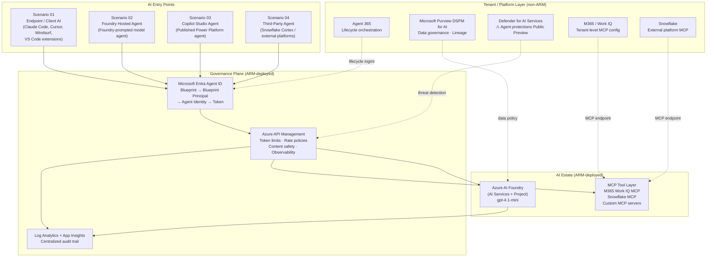
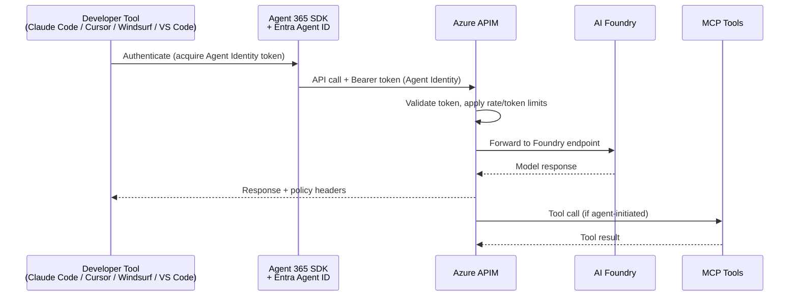
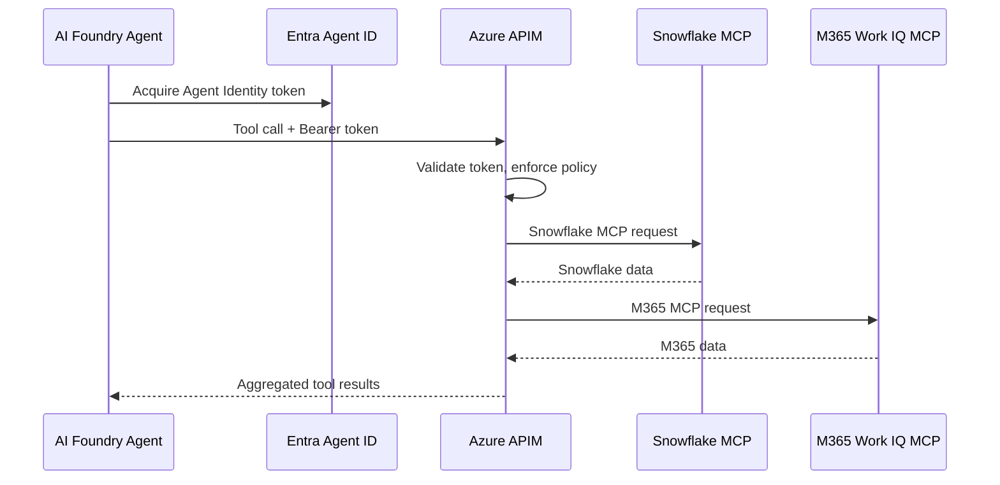
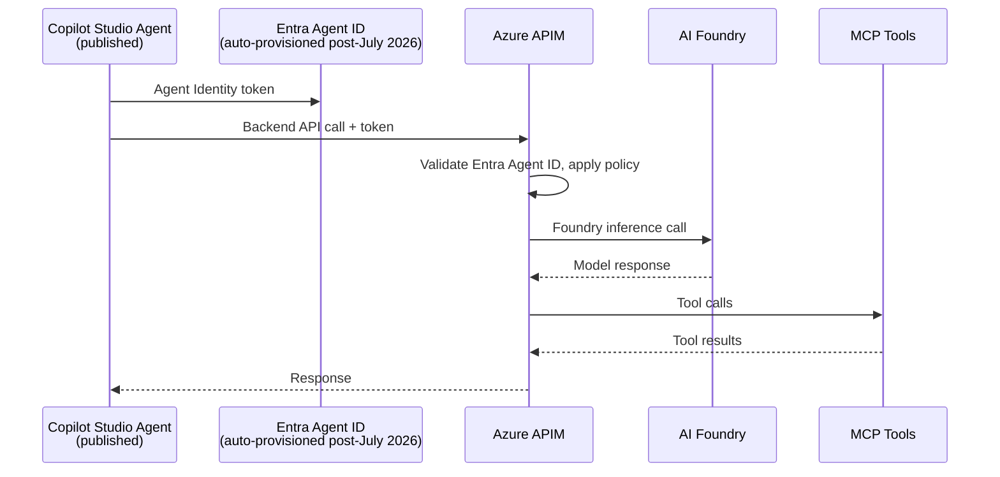
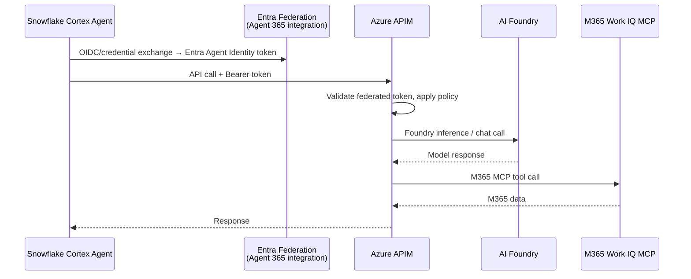

# Architecture Reference

> **One AI Estate. Four Entry Points. One Governance Plane.**

This document describes the full reference architecture for `ai-governance-at-scale`. For deployment steps and button URLs, see [deployment.md](deployment.md). For the Entra Agent ID identity model, see [concepts/agent-identity-model.md](concepts/agent-identity-model.md).

---

## High-Level Architecture



---

## Foundation Layer

The foundation is the permanent shared infrastructure that all scenarios depend on. It is deployed once into `rg-aigov-foundation-demo`.

### ARM-Deployed Resources

| Resource | Azure Service | SKU | Role |
|----------|--------------|-----|------|
| AI Gateway | Azure API Management | Developer (default); Standard v2 via parameter | Central policy enforcement point for all agent traffic |
| Container Apps Environment | Container Apps Managed Environment | Consumption | Shared runtime for all four scenario apps |
| AI Services | Microsoft.CognitiveServices/accounts (AI Services multi-model) | S0 | Shared model inference |
| Foundry Project | Microsoft.CognitiveServices/accounts/projects | — | Prompt management, evaluation, catalog |
| gpt-4.1-mini | CognitiveServices model deployment | Standard, 10K TPM | Default LLM; parameterized |
| Log Analytics Workspace | Microsoft.OperationalInsights/workspaces | Per-GB | Centralized logs |
| Application Insights | Microsoft.Insights/components | — | Distributed tracing |
| Key Vault | Microsoft.KeyVault/vaults | Standard | Secret storage |
| User-Assigned Identities (×4) | Microsoft.ManagedIdentity/userAssignedIdentities | — | Per-scenario workload identity |

### APIM Policy Architecture

```
Request → APIM Inbound Pipeline
  ├── Validate JWT (Entra Agent ID token)
  ├── Rate limit (per agent identity)
  ├── Token limit (per request / sliding window)
  ├── Content safety check (Azure AI Content Safety)
  └── Route to Foundry / MCP backend

Response → APIM Outbound Pipeline
  ├── Strip internal headers
  ├── Emit token consumption metrics → App Insights
  └── Return to agent
```

> **Developer SKU limitations:** No semantic caching, no VNet integration, no SLA. Set `apimSkuName=StandardV2` for production use. Semantic caching requires Standard v2 or higher.

> **MCP governance (Public Preview):** Controlled by `enableMcpGovernance` parameter (default: `false`). When enabled, adds MCP tool-level routing and governance policies. Requires an APIM tier that supports the AI Gateway preview feature.

---

## Scenario Architecture Overviews

### Scenario 01 — Endpoint / Client AI

Developer-facing AI tools authenticate as governed agents through APIM before reaching Foundry or MCP tools.



### Scenario 02 — Foundry Hosted Agent

An agent running inside Azure AI Foundry carries its own Entra Agent Identity and routes all tool calls through APIM.



### Scenario 03 — Copilot Studio Agent

A published Copilot Studio agent carries an Entra Agent ID (post-July 2026 rollout) and routes backend AI calls through APIM to Foundry, with MCP for data tools.



### Scenario 04 — Snowflake-Led Third-Party Agent

A Snowflake Cortex agent federates its identity into Entra, acquires an Agent Identity token, and calls Azure services through APIM.



---

## Identity Architecture

All agent identities follow the five-object Microsoft Entra Agent ID lifecycle model. See [`concepts/agent-identity-model.md`](concepts/agent-identity-model.md) for the authoritative explainer.

```
Agent Identity Blueprint
  └─► Blueprint Principal  (Entra service principal; trust anchor)
        └─► Agent Identity  (child SP with Agent subtype; runtime identity)
              └─► [optional] Agent's User Account  (delegated-user context)
                    └─► OAuth 2.0 / OIDC access tokens
```

**Key rule:** The Blueprint Principal is NOT the same object as an Agent Identity. Never conflate these two objects in architecture discussions or code.

---

## Observability Architecture

All scenarios emit telemetry to the shared foundation Log Analytics workspace and Application Insights instance.

| Signal | Source | Destination |
|--------|--------|------------|
| API gateway logs (requests, latency, policy hits) | APIM | Log Analytics |
| Token consumption metrics | APIM | App Insights |
| Container App runtime logs | Container Apps | Log Analytics |
| Agent evaluation traces | AI Foundry | Log Analytics |
| Security alerts | Defender for AI Services (Preview) | Microsoft Defender portal |
| Data governance events | Purview DSPM for AI | Purview portal |

---

## Deployment Regions and Sizing

| Parameter | Default | Notes |
|-----------|---------|-------|
| Location | East US 2 (`eastus2`) | All resources |
| APIM SKU | Developer | No SLA, no semantic caching. Use `StandardV2` for production |
| Container Apps vCPU | 0.25 per scenario app | 1 vCPU total at baseline |
| gpt-4.1-mini capacity | 10K TPM | Parameterized; adjust for load |

---

## Governance, Security, and Compliance Capabilities

| Capability | Product | Status |
|-----------|---------|--------|
| Agent identity and lifecycle | Microsoft Entra Agent ID | GA |
| Agent lifecycle orchestration | Agent 365 | GA |
| API policy enforcement | Azure APIM | GA |
| Content safety | APIM + Azure AI Content Safety | GA |
| Semantic caching | APIM Standard v2+ | GA (not available on Developer SKU) |
| MCP tool governance | APIM AI Gateway tier | **Public Preview** |
| Data governance and lineage | Purview DSPM for AI | Core GA; individual features vary |
| Threat detection (agents) | Defender for AI Services | **Public Preview** |

---

## Related Documentation

- [Deployment Operations and Rules](deployment.md)
- [Entra Agent ID Prerequisites](prerequisites/entra-agent-id.md)
- [Tenant Bootstrap Guide](prerequisites/tenant-bootstrap.md)
- [Agent Identity Model (Authoritative)](concepts/agent-identity-model.md)
- [Scenario 01 — Endpoint / Client AI](../scenarios/01-endpoint-ai/README.md)
- [Scenario 02 — Foundry Hosted Agent](../scenarios/02-foundry-agent/README.md)
- [Scenario 03 — Copilot Studio Agent](../scenarios/03-copilot-studio/README.md)
- [Scenario 04 — Snowflake-Led Third-Party Agent](../scenarios/04-snowflake-agent/README.md)
